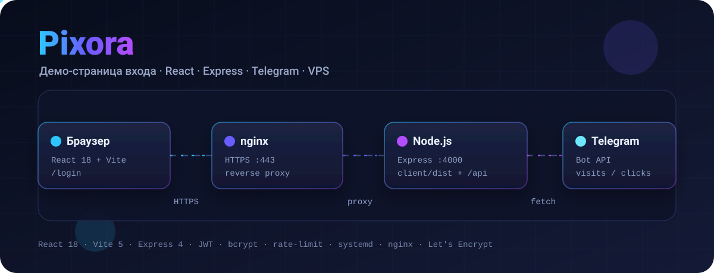

<p align="center">
  
</p>

<h1 align="center">Pixora</h1>

<p align="center">
  <b>Демо-страница входа</b> под собственным брендом: React 18 + Express + Telegram + VPS.<br/>
  Только экран входа — без Facebook, App Store и Google Play.
</p>

<p align="center">
  
  
  
  
  
  
</p>

<p align="center">
  <a href="docs/README.md">📚 Документация</a> ·
  <a href="docs/09-animated-architecture.md">🎬 Анимированная архитектура</a> ·
  <a href="docs/08-vps-full-guide.md">🛠️ Деплой на VPS</a> ·
  <a href="RESULT.md">✅ Итог</a>
</p>

> **Важно.** Это не клон Instagram и не фишинговая страница. Бренд, логотип и домен — свои, пароли хешируются и **никогда не покидают сервер**. В Telegram уходят только метаданные событий (визит, клик, вход, время, IP, браузер). Проект не связан с Instagram или Meta.

---

## Что умеет

| Возможность | Описание |
|---|---|
| `/login` | Единственный публичный экран: форма входа с плавающими подписями, показом пароля, кнопкой «Войти» и «Забыли пароль?» |
| Другие адреса | Перенаправляются на `/login` — в демо нет ни регистрации, ни профиля |
| Внешний вид | Карточка 350 px, рамка `#dbdbdb`, мокап телефона с лентой, свой логотип-апертура и название **Pixora**. Без логотипов Instagram/Meta, без кнопок App Store / Google Play и без входа через Facebook |
| Адаптив | На узких экранах мокап скрывается, карточка становится полноширинной |
| Бэкенд | Express: вход, JWT (7 дней), bcrypt (cost 12), rate limit 30 попыток / 15 мин |
| Telegram | Два типа уведомлений: **визит** («открыта страница») и **клик** («нажата кнопка»). В сообщении время, IP, браузер/ОС, опционально гео. **Значения полей формы и пароли не отправляются** |
| Аккаунты | Регистрации нет: демо-пользователя создаёт администратор командой `npm run user:add` |
| Деплой | Один Node-сервис + nginx + Let's Encrypt. Подробно — в `docs/08-vps-full-guide.md` |

## Стек

- **Frontend:** React 18, React Router 6, Vite 5, чистый CSS
- **Backend:** Node.js 20+, Express 4, bcryptjs, jsonwebtoken, helmet, express-rate-limit
- **Хранилище:** JSON-файл `server/data/users.json` (для демо; легко заменить на PostgreSQL)
- **Инфраструктура:** nginx (reverse proxy), systemd, certbot

## Структура проекта

```
InstagramWeb/
├─ client/                  # React-приложение (Vite)
│  ├─ index.html
│  ├─ vite.config.js        # прокси /api → localhost:4000
│  └─ src/
│     ├─ pages/             # LoginPage (RegisterPage/HomePage не подключены к роутингу)
│     ├─ components/        # AuthLayout, FloatingInput, Logo, PhoneMockup
│     ├─ styles/global.css  # вся визуальная часть
│     ├─ api.js             # обёртка над fetch
│     ├─ analytics.js       # отправка событий «визит»/«клик»
│     └─ auth.js            # хранение JWT
├─ server/                  # Express API
│  ├─ src/
│  │  ├─ index.js           # точка входа, статика, роуты, ошибки
│  │  ├─ config.js          # чтение .env
│  │  ├─ store.js           # JSON-хранилище пользователей
│  │  ├─ telegram.js        # уведомления о входе и событиях интерфейса
│  │  └─ routes/
│  │     ├─ auth.js         # login / me / logout
│  │     └─ events.js       # визит / клик
│  ├─ scripts/add-user.js   # создание демо-аккаунта
│  ├─ data/                 # users.json (не коммитится)
│  └─ .env.example
├─ deploy/
│  ├─ nginx.conf            # конфиг сайта
│  ├─ pixora-api.service    # systemd unit
│  └─ deploy.sh             # обновление на сервере
├─ docs/                    # подробная документация
└─ .github/workflows/ci.yml # сборка на GitHub Actions
```

---

## Быстрый старт (5 минут)

Нужен **Node.js 20+** (рекомендуется LTS 22) и npm. Проверка:

```bash
node -v
npm -v
```

### 1. Установить зависимости

Из **корня** проекта (не из `client/` и не из `server/`):

```bash
npm install
```

Проект использует npm workspaces — одной командой ставятся зависимости и фронтенда, и бэкенда.

### 2. Создать `server/.env`

**Windows (PowerShell):**

```powershell
Copy-Item server\.env.example server\.env
```

**macOS / Linux:**

```bash
cp server/.env.example server/.env
```

Открыть `server/.env` и как минимум задать:

```env
JWT_SECRET=<длинная случайная строка>
TELEGRAM_BOT_TOKEN=<токен бота>
TELEGRAM_CHAT_ID=<id чата>
```

Сгенерировать секрет:

```bash
# macOS / Linux / Git Bash
openssl rand -hex 32
```

```powershell
# Windows PowerShell
node -e "console.log(require('crypto').randomBytes(32).toString('hex'))"
```

Как получить токен бота и chat_id — см. [docs/04-telegram.md](docs/04-telegram.md).

### 3. Создать демо-аккаунт

Регистрации на сайте нет — пользователя добавляет администратор:

```bash
npm run user:add -- demo@example.com demo_user "Пароль12345"
```

Требования: корректный email, логин 3–30 символов (латиница, цифры, `.`, `_`), пароль от 8 символов.
Пароль хешируется bcrypt и в открытом виде не сохраняется.

### 4. Запустить

```bash
npm run dev
```

Открыть:

- **http://localhost:5173/login** — страница входа (единственный экран)
- **http://localhost:4000/api/health** — проверка API

Войдите созданным аккаунтом — в Telegram придёт уведомление о входе.
Откройте страницу и нажмите кнопки — придут события «открыта страница» и «клик».

### 5. Проверить production-сборку локально

```bash
npm run build
npm start
```

Открыть **http://localhost:4000/login** — Node отдаст собранный фронтенд и API с одного порта.

> На Windows, если порт занят, закройте старый процесс: `Get-NetTCPConnection -LocalPort 4000 | Select-Object OwningProcess` и `Stop-Process -Id <PID>`.

---

## Переменные окружения

Все переменные — в `server/.env` (шаблон: `server/.env.example`).

| Переменная | Обязательно | По умолчанию | Назначение |
|---|---|---|---|
| `PORT` | нет | `4000` | Порт API |
| `NODE_ENV` | для прода | `development` | `production` на сервере |
| `JWT_SECRET` | **да** | — | Секрет подписи токенов, минимум 32 байта |
| `JWT_EXPIRES_IN` | нет | `7d` | Срок жизни сессии |
| `CLIENT_ORIGIN` | для CORS | `http://localhost:5173` | Разрешённые origin через запятую |
| `TRUST_PROXY` | за nginx | `true` | Брать IP из `X-Forwarded-For` |
| `SERVE_STATIC` | нет | `true` | Отдавать `client/dist` из Node |
| `TELEGRAM_BOT_TOKEN` | для TG | — | Токен от @BotFather |
| `TELEGRAM_CHAT_ID` | для TG | — | Куда присылать (личка/группа/канал) |
| `TELEGRAM_ENABLED` | нет | `true` | Быстро выключить уведомления |
| `TZ_NAME` | нет | `Europe/Moscow` | Часовой пояс в сообщении |
| `GEOIP_ENABLED` | нет | `false` | Город по IP через ip-api.com |
| `DATA_DIR` | нет | `./data` | Каталог для `users.json` |

---

## Скрипты

| Команда | Что делает |
|---|---|
| `npm run dev` | API (`--watch`) + Vite одновременно |
| `npm run dev:api` | только API на :4000 |
| `npm run dev:web` | только фронтенд на :5173 |
| `npm run build` | сборка клиента в `client/dist` |
| `npm start` | API + раздача `client/dist` на :4000 |

---

## Документация

| Файл | О чём |
|---|---|
| [docs/README.md](docs/README.md) | **Анимированный хаб документации:** схемы, быстрый старт, навигация |
| [docs/01-local-start.md](docs/01-local-start.md) | Подробный локальный запуск: установка Node, `.env`, проверка, типичные ошибки |
| [docs/02-vps-deploy.md](docs/02-vps-deploy.md) | VPS с нуля: SSH, пользователь, firewall, Node, systemd, nginx |
| [docs/03-domain-https.md](docs/03-domain-https.md) | Домен, DNS, HTTPS через Let's Encrypt, автопродление |
| [docs/04-telegram.md](docs/04-telegram.md) | Бот, chat_id, формат сообщения, диагностика |
| [docs/05-troubleshooting.md](docs/05-troubleshooting.md) | Симптом → причина → решение |
| [docs/06-security.md](docs/06-security.md) | Что храним, что нет, чек-лист безопасности |
| [docs/07-github.md](docs/07-github.md) | Публикация в GitHub без утечки секретов |
| [docs/08-vps-full-guide.md](docs/08-vps-full-guide.md) | **Полный гайд по VPS:** от покупки сервера до HTTPS, обновлений и бэкапов |
| [docs/09-animated-architecture.md](docs/09-animated-architecture.md) | **Анимированная документация:** SVG-шапка, Mermaid-схемы архитектуры, последовательностей и деплоя |

---

## Безопасность в двух словах

- Пароли хешируются `bcrypt` (cost 12) и **не логируются и не отправляются** ни в Telegram, ни на фронтенд.
- В Telegram уходит только событие: `@username`, email, время, IP, браузер/ОС.
- JWT подписывается секретом из `.env`; файл `.env` в `.gitignore`.
- На `/api/auth/*` стоит rate limit (30 запросов / 15 минут с одного IP).
- Ответ при неверном логине всегда один и тот же — нельзя узнать, существует ли аккаунт.
- HTTPS обязателен в продакшене: см. [docs/03-domain-https.md](docs/03-domain-https.md).

Подробнее — [docs/06-security.md](docs/06-security.md).

---

## Ограничения демо

- Пользователи хранятся в JSON-файле: подходит для демонстрации и небольшой нагрузки, но не для высоконагруженного продакшена. Замена на PostgreSQL/SQLite — в `server/src/store.js`.
- Нет регистрации, подтверждения email, сброса пароля и 2FA: демо-аккаунт создаёт администратор.
- Нет входа через Facebook и кнопок магазинов приложений — они удалены.
- Логотип и название — собственные (Pixora). Логотипы Instagram/Meta не используются.
- Шрифт логотипа подгружается с Google Fonts; без интернета используется системный курсив.

## Лицензия и правовая заметка

Код можно использовать свободно в учебных и личных целях. Название и логотип Instagram/Meta не используются. Не размещайте этот проект под чужим брендом и не используйте для сбора чужих паролей — это незаконно.
