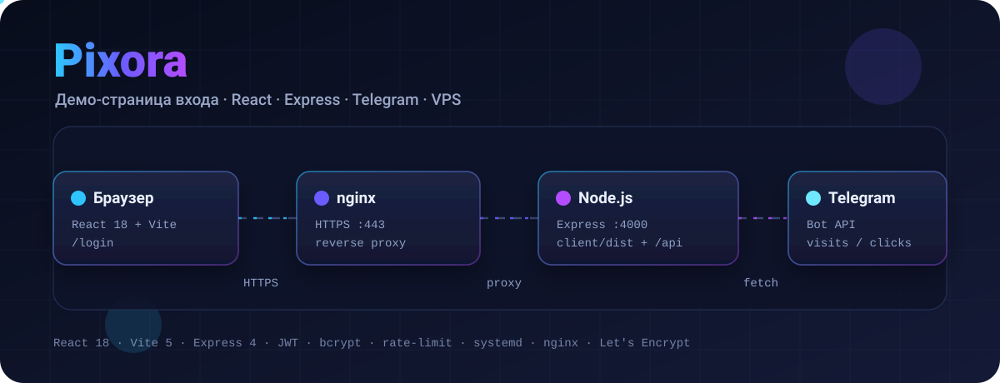
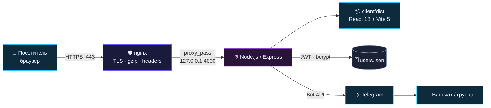
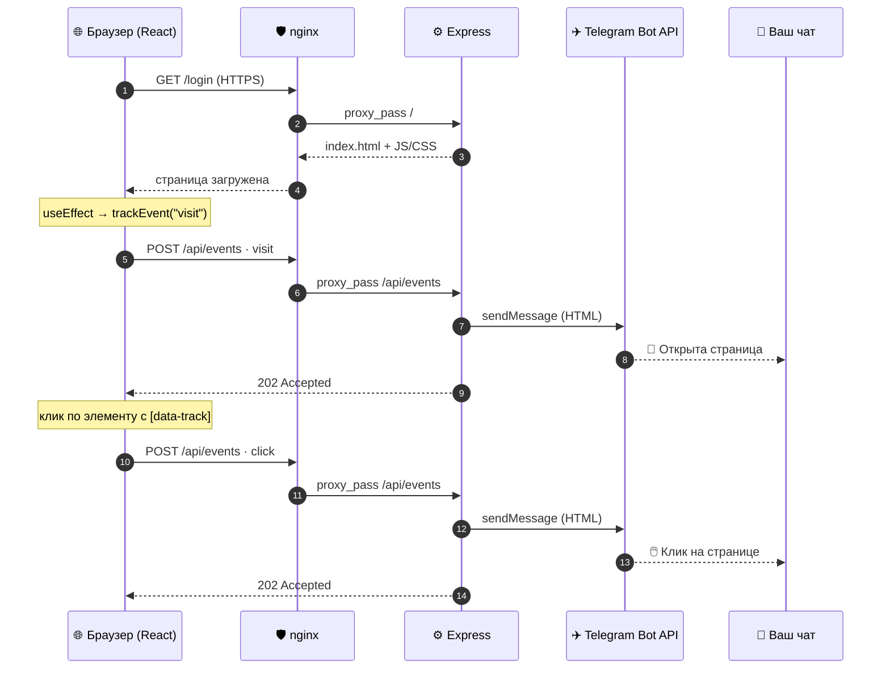
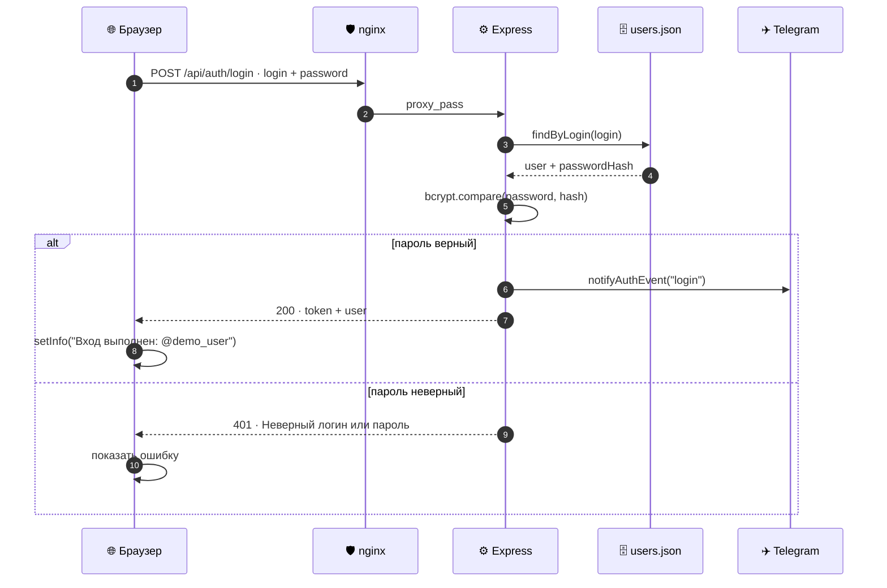
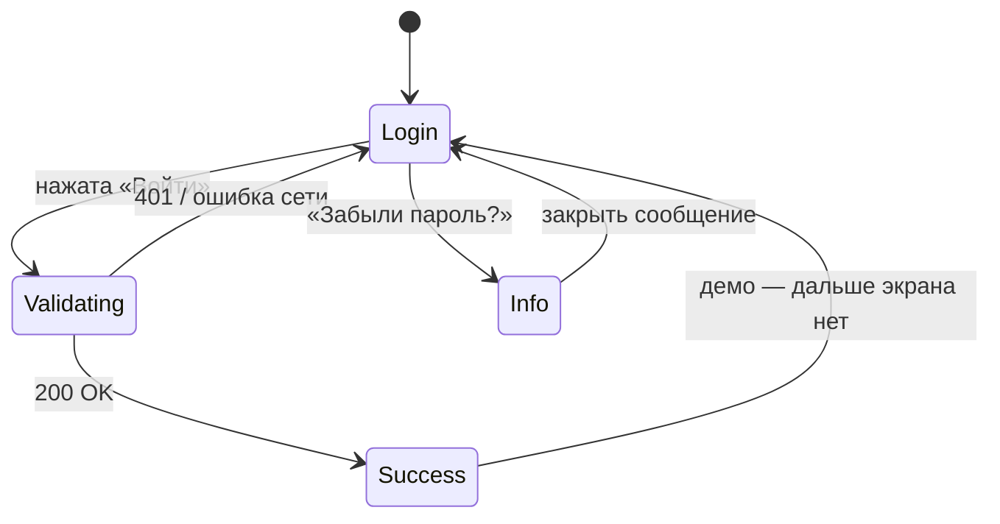
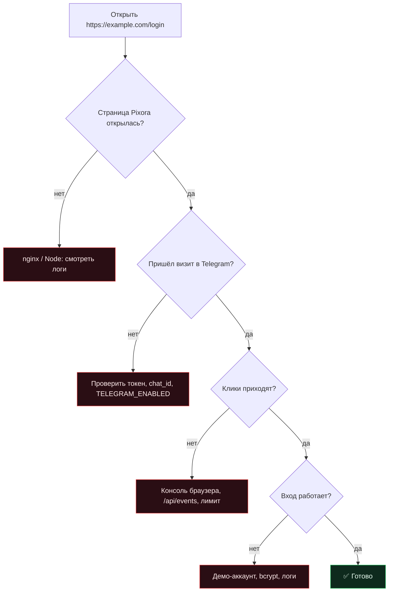
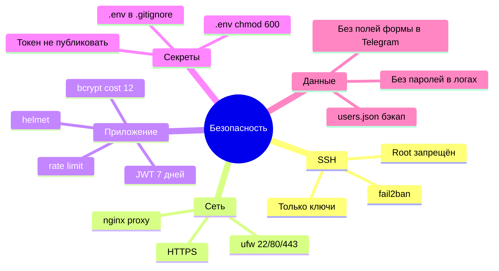

# Pixora — анимированная архитектура и полный деплой на VPS

<p align="center">
  
</p>

<p align="center">
  
  
  
  
  
  
</p>

> **Что это.** Учебный демо-проект **Pixora**: страница входа под собственным брендом,
> React + Express + Telegram-уведомления, деплой на VPS с HTTPS. Проект **не является
> копией Instagram**, не использует логотипы Instagram/Meta и не предназначен для
> сбора чужих паролей.
>
> **Про анимацию.** SVG-шапка выше анимирована (SMIL/CSS) и оживает в браузере.
> Mermaid-схемы ниже анимируются в рендерерах, которые это поддерживают (например,
> локальный предпросмотр Markdown). На GitHub они отображаются статично, но
> структура и подписи полностью читаемы.

---

## Содержание

- [1. Что умеет проект](#1-что-умеет-проект)
- [2. Живая архитектура](#2-живая-архитектура)
- [3. Путь запроса: визит и клик](#3-путь-запроса-визит-и-клик)
- [4. Путь запроса: вход](#4-путь-запроса-вход)
- [5. Состояния экрана](#5-состояния-экрана)
- [6. Стек и структура](#6-стек-и-структура)
- [7. API](#7-api)
- [8. Переменные окружения](#8-переменные-окружения)
- [9. Локальный запуск](#9-локальный-запуск)
- [10. Telegram-бот](#10-telegram-бот)
- [11. Деплой на VPS: таймлайн](#11-деплой-на-vps-таймлайн)
- [12. Деплой на VPS: шаги](#12-деплой-на-vps-шаги)
- [13. systemd](#13-systemd)
- [14. nginx](#14-nginx)
- [15. Домен и HTTPS](#15-домен-и-https)
- [16. Проверка](#16-проверка)
- [17. Обновления](#17-обновления)
- [18. Бэкапы](#18-бэкапы)
- [19. Логи и диагностика](#19-логи-и-диагностика)
- [20. Безопасность](#20-безопасность)
- [21. Типовые ошибки](#21-типовые-ошибки)
- [22. Шпаргалка](#22-шпаргалка)

---

## 1. Что умеет проект

| Возможность | Как работает |
|---|---|
| Экран входа `/login` | Единственная публичная страница. Все остальные адреса редиректят на неё |
| Свой бренд | Название **Pixora**, оригинальный знак-апертура, без логотипов Instagram/Meta |
| Без лишнего | Нет Facebook-входа, App Store, Google Play и публичной регистрации |
| Вход | Логин/email + пароль, bcrypt (cost 12), JWT на 7 дней |
| Telegram: визит | При открытии `/login` уходит «👀 Открыта страница» |
| Telegram: клик | При нажатии кнопок/ссылок уходит «🖱️ Клик на странице» |
| Telegram: вход | При успешном логине уходит «🔐 Вход в аккаунт» |
| Приватность | В Telegram **не** уходят пароли и значения полей формы |
| Демо-аккаунт | Создаётся командой `npm run user:add` |
| Деплой | Node + systemd + nginx + Let's Encrypt, один сервис на порту 4000 |

---

## 2. Живая архитектура



**Ключевая идея:** один Node-процесс отдаёт и собранный React, и API. nginx стоит
спереди, принимает HTTPS и проксирует всё на `127.0.0.1:4000`. Меньше сервисов —
меньше точек отказа.

---

## 3. Путь запроса: визит и клик



**Что именно уходит в Telegram:**

```
👀 Открыта страница · Pixora

📄 Страница: /login
🏷️ Действие: Открыта страница входа
🕒 Время: 26.11.2026, 14:32 (Europe/Moscow)
🌐 IP: 203.0.113.10
💻 Устройство: Chrome · Windows
📍 Гео: Москва, Москва, Russia   (если GEOIP_ENABLED=true)
```

**Чего там нет:** логина, email, пароля и любых значений из полей ввода.
Клиент отправляет только `type`, `label` и `path`.

---

## 4. Путь запроса: вход



**Защита:**

- пароль сравнивается с bcrypt-хешем, в открытом виде не хранится;
- для несуществующего пользователя всё равно выполняется bcrypt-сравнение
  (защита от определения аккаунта по времени ответа);
- rate limit: 30 попыток за 15 минут с одного IP;
- JWT подписывается секретом из `.env`.

---

## 5. Состояния экрана



---

## 6. Стек и структура

### Стек

| Слой | Технологии |
|---|---|
| Frontend | React 18, React Router 6, Vite 5, чистый CSS |
| Backend | Node.js 22, Express 4, helmet, cors, express-rate-limit |
| Авторизация | bcryptjs (cost 12), jsonwebtoken (7 дней) |
| Хранилище | JSON-файл `server/data/users.json` (демо) |
| Уведомления | Telegram Bot API |
| Инфраструктура | Ubuntu 24.04, systemd, nginx, certbot, Let's Encrypt |

### Структура

```text
InstagramWeb/
├─ client/                      # React (Vite)
│  ├─ index.html
│  ├─ vite.config.js            # прокси /api → localhost:4000
│  └─ src/
│     ├─ pages/LoginPage.jsx    # единственный экран
│     ├─ components/            # AuthLayout, FloatingInput, Logo, PhoneMockup
│     ├─ styles/global.css      # вся визуальная часть
│     ├─ analytics.js           # события «визит»/«клик»
│     ├─ api.js                 # обёртка над fetch
│     └─ auth.js                # хранение JWT
├─ server/                      # Express API
│  ├─ src/
│  │  ├─ index.js               # точка входа, статика, роуты
│  │  ├─ config.js              # чтение .env
│  │  ├─ store.js               # JSON-хранилище
│  │  ├─ telegram.js            # отправка уведомлений
│  │  └─ routes/
│  │     ├─ auth.js             # login / me / logout
│  │     └─ events.js           # visit / click
│  ├─ scripts/add-user.js       # создание демо-аккаунта
│  ├─ data/                     # users.json (не коммитится)
│  └─ .env.example
├─ deploy/
│  ├─ nginx.conf
│  ├─ pixora-api.service
│  └─ deploy.sh
├─ docs/
│  ├─ 08-vps-full-guide.md
│  └─ 09-animated-architecture.md   # этот файл
├─ package.json                 # npm workspaces
└─ README.md
```

---

## 7. API

| Метод | Путь | Тело | Ответ |
|---|---|---|---|
| `GET` | `/api/health` | — | `{ok:true, uptime, env}` |
| `POST` | `/api/auth/login` | `{login, password}` | `200 {token, user}` или `401` |
| `GET` | `/api/auth/me` | заголовок `Authorization: Bearer <JWT>` | `200 {user}` |
| `POST` | `/api/auth/logout` | — | `{ok:true}` |
| `POST` | `/api/events` | `{type:"visit"\|"click", label, path}` | `202 {ok:true}` |

Лимиты:

- `/api/auth/*` — 30 запросов / 15 минут с IP;
- `/api/events` — 60 запросов / минуту с IP.

---

## 8. Переменные окружения

Файл `server/.env` (шаблон — `server/.env.example`).

| Переменная | Обязательно | По умолчанию | Назначение |
|---|---|---|---|
| `PORT` | нет | `4000` | Порт API |
| `NODE_ENV` | для прода | `development` | На сервере — `production` |
| `JWT_SECRET` | **да** | — | Секрет подписи токенов, 32+ байта |
| `JWT_EXPIRES_IN` | нет | `7d` | Срок жизни сессии |
| `CLIENT_ORIGIN` | для CORS | `http://localhost:5173` | Разрешённые origin через запятую |
| `TRUST_PROXY` | за nginx | `true` | Брать IP из `X-Forwarded-For` |
| `SERVE_STATIC` | нет | `true` | Отдавать `client/dist` из Node |
| `TELEGRAM_BOT_TOKEN` | для TG | — | Токен от `@BotFather` |
| `TELEGRAM_CHAT_ID` | для TG | — | Личка, группа или канал |
| `TELEGRAM_ENABLED` | нет | `true` | Быстро выключить уведомления |
| `TZ_NAME` | нет | `Europe/Moscow` | Часовой пояс в сообщении |
| `GEOIP_ENABLED` | нет | `false` | Город по IP через ip-api.com |
| `DATA_DIR` | нет | `./data` | Каталог для `users.json` |

---

## 9. Локальный запуск

Нужен **Node.js 20+** (проверено на 22).

```bash
npm install
```

Создайте `.env`:

```bash
cp server/.env.example server/.env
```

Заполните минимум:

```env
JWT_SECRET=<openssl rand -hex 32>
TELEGRAM_BOT_TOKEN=<токен бота>
TELEGRAM_CHAT_ID=<chat_id>
```

Создайте демо-аккаунт:

```bash
npm run user:add -- demo@example.com demo_user "Пароль12345"
```

Запустите:

```bash
npm run dev
```

- `http://localhost:5173/login` — страница входа;
- `http://localhost:4000/api/health` — проверка API.

Production-сборка локально:

```bash
npm run build
npm start
# http://localhost:4000/login
```

---

## 10. Telegram-бот

### 1. Создать бота

1. Откройте Telegram → **@BotFather**.
2. `/newbot` → имя → username (заканчивается на `bot`).
3. Скопируйте токен `123456789:AAH...`.

### 2. Узнать chat_id

Напишите боту `/start`, затем:

```bash
curl -s "https://api.telegram.org/bot<ТОКЕН>/getUpdates"
```

Найдите `"chat":{"id":123456789}`. Для группы id отрицательный (`-100...`),
бот должен быть в группе; для канала — администратором.

### 3. Проверить

```bash
curl -s -X POST "https://api.telegram.org/bot<ТОКЕН>/sendMessage" \
  -H "Content-Type: application/json" \
  -d '{"chat_id":"<CHAT_ID>","text":"Проверка Pixora"}'
```

### 4. Вписать в `.env`

```env
TELEGRAM_BOT_TOKEN=123456789:AAH...
TELEGRAM_CHAT_ID=123456789
TELEGRAM_ENABLED=true
```

> Токен — это пароль от бота. Не коммитьте `.env`, не вставляйте токен в скриншоты.

---

## 11. Деплой на VPS: таймлайн

```mermaid
gantt
    title Деплой Pixora на VPS (~40 минут)
    dateFormat  HH:mm
    axisFormat  %H:%M
    section Подготовка
    VPS + SSH + обновление системы      :a1, 00:00, 10m
    Пользователь, ключи, ufw, fail2ban  :a2, after a1, 10m
    section Установка
    Node.js 22, nginx, certbot          :b1, after a2, 8m
    Клон репозитория и сборка           :b2, after b1, 6m
    section Запуск
    .env + демо-аккаунт                 :c1, after b2, 4m
    systemd + nginx                     :c2, after c1, 5m
    section HTTPS
    DNS + certbot                       :d1, after c2, 8m
    Проверка сайта и Telegram           :d2, after d1, 5m
```



---

## 12. Деплой на VPS: шаги

### 12.1. Требования

| Параметр | Значение |
|---|---|
| ОС | Ubuntu 24.04 LTS (или 22.04) |
| CPU | 1 vCPU |
| RAM | 1 ГБ (лучше 2 ГБ) |
| Диск | 10 ГБ SSD |
| Домен | желателен для HTTPS |

### 12.2. Первый вход

```bash
ssh root@203.0.113.10
apt update && apt upgrade -y
apt install -y git curl ufw nano unzip
```

Если обновилось ядро:

```bash
reboot
```

### 12.3. Пользователь и ключи

```bash
adduser pixora
usermod -aG sudo pixora
```

На **своём компьютере**:

```bash
ssh-keygen -t ed25519 -C "pixora-vps"
```

**Windows PowerShell:**

```powershell
type $env:USERPROFILE\.ssh\id_ed25519.pub | ssh root@203.0.113.10 "mkdir -p /home/pixora/.ssh && cat >> /home/pixora/.ssh/authorized_keys && chown -R pixora:pixora /home/pixora/.ssh && chmod 700 /home/pixora/.ssh && chmod 600 /home/pixora/.ssh/authorized_keys"
```

**macOS / Linux:**

```bash
ssh-copy-id -i ~/.ssh/id_ed25519.pub pixora@203.0.113.10
```

Проверьте вход без пароля, затем на сервере:

```bash
sudo nano /etc/ssh/sshd_config
```

```text
PermitRootLogin no
PasswordAuthentication no
PubkeyAuthentication yes
```

```bash
sudo systemctl restart ssh
```

> Не закрывайте текущую сессию, пока не проверите вход в новом окне.

### 12.4. Firewall

```bash
sudo ufw allow OpenSSH
sudo ufw allow 80/tcp
sudo ufw allow 443/tcp
sudo ufw enable
sudo ufw status verbose
```

### 12.5. Swap (для 1 ГБ RAM)

```bash
sudo fallocate -l 2G /swapfile
sudo chmod 600 /swapfile
sudo mkswap /swapfile
sudo swapon /swapfile
echo '/swapfile none swap sw 0 0' | sudo tee -a /etc/fstab
free -h
```

### 12.6. Node.js, nginx, certbot

```bash
curl -fsSL https://deb.nodesource.com/setup_22.x -o /tmp/nodesource_setup.sh
sudo bash /tmp/nodesource_setup.sh
sudo apt install -y nodejs nginx certbot python3-certbot-nginx
node -v
npm -v
```

### 12.7. Код и сборка

```bash
sudo mkdir -p /var/www
sudo chown pixora:pixora /var/www
cd /var/www
git clone https://github.com/JamikKhidirov/InstWeb.git pixora
cd pixora
npm ci --no-audit --no-fund
npm run build
ls client/dist
```

### 12.8. `.env`

```bash
cd server
cp .env.example .env
chmod 600 .env
nano .env
```

```env
PORT=4000
NODE_ENV=production
JWT_SECRET=<openssl rand -hex 32>
JWT_EXPIRES_IN=7d
CLIENT_ORIGIN=https://example.com,https://www.example.com
TRUST_PROXY=true
SERVE_STATIC=true
TELEGRAM_BOT_TOKEN=<токен>
TELEGRAM_CHAT_ID=<chat_id>
TELEGRAM_ENABLED=true
TZ_NAME=Europe/Moscow
GEOIP_ENABLED=false
DATA_DIR=./data
```

### 12.9. Демо-аккаунт

```bash
cd /var/www/pixora
npm run user:add -- demo@example.com demo_user "Пароль12345"
```

---

## 13. systemd

```bash
sudo cp deploy/pixora-api.service /etc/systemd/system/pixora-api.service
sudo nano /etc/systemd/system/pixora-api.service
```

```ini
[Unit]
Description=Pixora auth API (Node.js)
After=network-online.target
Wants=network-online.target

[Service]
Type=simple
User=pixora
Group=pixora
WorkingDirectory=/var/www/pixora/server
EnvironmentFile=/var/www/pixora/server/.env
ExecStart=/usr/bin/node src/index.js

Restart=always
RestartSec=3
KillSignal=SIGTERM
TimeoutStopSec=15

NoNewPrivileges=true
PrivateTmp=true
ProtectSystem=strict
ProtectHome=true
ProtectKernelTunables=true
ProtectKernelModules=true
ProtectControlGroups=true
RestrictSUIDSGID=true
LockPersonality=true
ReadWritePaths=/var/www/pixora/server/data

StandardOutput=journal
StandardError=journal
SyslogIdentifier=pixora-api

[Install]
WantedBy=multi-user.target
```

```bash
sudo systemctl daemon-reload
sudo systemctl enable --now pixora-api
sudo systemctl status pixora-api --no-pager
curl http://127.0.0.1:4000/api/health
```

---

## 14. nginx

```bash
sudo cp deploy/nginx.conf /etc/nginx/sites-available/pixora
sudo nano /etc/nginx/sites-available/pixora
```

```nginx
server {
    listen 80;
    listen [::]:80;

    server_name example.com www.example.com;

    client_max_body_size 1m;

    add_header X-Content-Type-Options "nosniff" always;
    add_header X-Frame-Options "SAMEORIGIN" always;
    add_header Referrer-Policy "strict-origin-when-cross-origin" always;
    add_header Permissions-Policy "geolocation=(), microphone=(), camera=()" always;

    gzip on;
    gzip_comp_level 5;
    gzip_min_length 512;
    gzip_vary on;
    gzip_types text/plain text/css application/javascript application/json image/svg+xml;

    location / {
        proxy_pass http://127.0.0.1:4000;
        proxy_http_version 1.1;

        proxy_set_header Host              $host;
        proxy_set_header X-Real-IP         $remote_addr;
        proxy_set_header X-Forwarded-For   $proxy_add_x_forwarded_for;
        proxy_set_header X-Forwarded-Proto $scheme;

        proxy_connect_timeout 5s;
        proxy_read_timeout    30s;
        proxy_send_timeout    30s;
    }
}
```

```bash
sudo ln -sf /etc/nginx/sites-available/pixora /etc/nginx/sites-enabled/pixora
sudo rm -f /etc/nginx/sites-enabled/default
sudo nginx -t
sudo systemctl reload nginx
```

Пока домена нет — поставьте `server_name _;` и откройте `http://IP/login`.

---

## 15. Домен и HTTPS

DNS:

| Тип | Имя | Значение |
|---|---|---|
| A | `@` | `203.0.113.10` |
| A | `www` | `203.0.113.10` |

Проверка:

```bash
dig +short example.com
```

Сертификат:

```bash
sudo certbot --nginx -d example.com -d www.example.com
```

Выберите **Redirect** (HTTP → HTTPS). Проверка автопродления:

```bash
sudo certbot renew --dry-run
sudo systemctl status certbot.timer
```

Обновите `.env` и перезапустите:

```env
CLIENT_ORIGIN=https://example.com,https://www.example.com
```

```bash
sudo systemctl restart pixora-api
```

---

## 16. Проверка



Команды:

```bash
curl https://example.com/api/health
curl -X POST https://example.com/api/events \
  -H "Content-Type: application/json" \
  -d '{"type":"visit","label":"Проверка","path":"/login"}'
sudo journalctl -u pixora-api -n 80 --no-pager
```

---

## 17. Обновления

```bash
cd /var/www/pixora
bash deploy/deploy.sh
```

Скрипт: `git pull` → `npm install` → `npm run build` → `systemctl restart` →
проверка `/api/health`.

Если менялся `.env`:

```bash
sudo systemctl restart pixora-api
```

Если менялся nginx:

```bash
sudo cp deploy/nginx.conf /etc/nginx/sites-available/pixora
sudo nginx -t && sudo systemctl reload nginx
```

---

## 18. Бэкапы

```bash
sudo mkdir -p /var/backups/pixora
sudo crontab -e
```

```cron
0 4 * * * tar -czf /var/backups/pixora/users-$(date +\%F).tgz -C /var/www/pixora/server/data users.json
0 5 1 * * find /var/backups/pixora -name 'users-*.tgz' -mtime +30 -delete
```

Скачать к себе:

```powershell
scp pixora@203.0.113.10:/var/backups/pixora/users-2026-11-26.tgz .
```

---

## 19. Логи и диагностика

```bash
# Сервис
sudo systemctl status pixora-api
sudo journalctl -u pixora-api -f

# nginx
sudo tail -n 100 /var/log/nginx/access.log
sudo tail -n 100 /var/log/nginx/error.log
sudo nginx -t

# Порты
sudo ss -tulpn | grep -E ':(22|80|443|4000)'

# API
curl -i http://127.0.0.1:4000/api/health
curl -i https://example.com/api/health
```

---

## 20. Безопасность



Чек-лист:

- [ ] `PermitRootLogin no`, `PasswordAuthentication no`;
- [ ] вход по ключу проверен в новом окне;
- [ ] `ufw` активен, открыты только 22/80/443;
- [ ] `fail2ban` работает;
- [ ] `NODE_ENV=production`;
- [ ] `JWT_SECRET` — случайные 32+ байта;
- [ ] `server/.env` — права `600`;
- [ ] `.env` не в git;
- [ ] HTTPS включён, HTTP редиректит;
- [ ] `TRUST_PROXY=true`;
- [ ] бэкапы проверены;
- [ ] в Telegram не уходят пароли и значения полей;
- [ ] проект остаётся **Pixora**, без чужих логотипов.

---

## 21. Типовые ошибки

| Симптом | Причина | Решение |
|---|---|---|
| `502 Bad Gateway` | Node не запущен / другой порт | `systemctl status pixora-api`, `curl 127.0.0.1:4000/api/health` |
| `404` на `/login` | nginx ищет файл | Проверить `location / { proxy_pass ... }` |
| Сайт не открывается по домену | DNS / `server_name` | `dig +short domain`, подождать, проверить конфиг |
| certbot не выдаёт сертификат | Домен не указывает на сервер | Проверить DNS и `ufw` |
| IP в Telegram `127.0.0.1` | Нет `TRUST_PROXY` | `TRUST_PROXY=true`, перезапуск |
| Telegram молчит | Токен / chat_id / бот не начат | `curl sendMessage`, `/start` боту |
| `EADDRINUSE :4000` | Порт занят | `ss -tulpn \| grep 4000` |
| Сборка падает по памяти | Мало RAM | Добавить swap |
| `Permission denied` в `data` | Владелец файлов | `chown -R pixora:pixora /var/www/pixora` |
| `429 Too Many Requests` | Rate limit | Подождать 15 минут / минуту |

---

## 22. Шпаргалка

```bash
# Статус и логи
sudo systemctl status pixora-api
sudo journalctl -u pixora-api -f

# Перезапуск
sudo systemctl restart pixora-api

# Обновление
cd /var/www/pixora && bash deploy/deploy.sh

# Пересборка
cd /var/www/pixora && npm ci && npm run build

# Новый демо-аккаунт
cd /var/www/pixora && npm run user:add -- user@example.com user_name "Пароль12345"

# API
curl http://127.0.0.1:4000/api/health

# nginx
sudo nginx -t && sudo systemctl reload nginx

# HTTPS
sudo certbot renew --dry-run

# Firewall
sudo ufw status verbose

# Бэкап
sudo tar -czf /var/backups/pixora/users-$(date +%F).tgz -C /var/www/pixora/server/data users.json
```

---

<p align="center">
  <b>Pixora</b> — учебный демо-проект. React + Express + Telegram + VPS.<br/>
  Не связан с Instagram или Meta.
</p>
