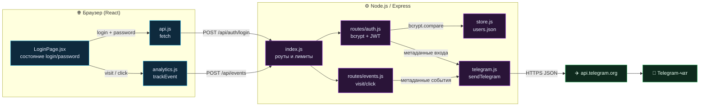
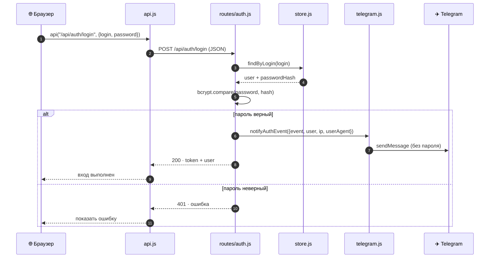
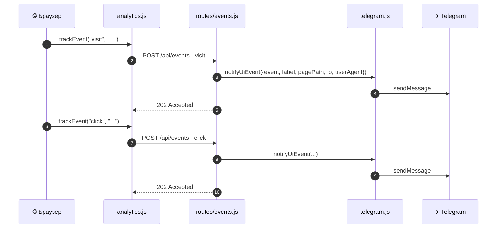
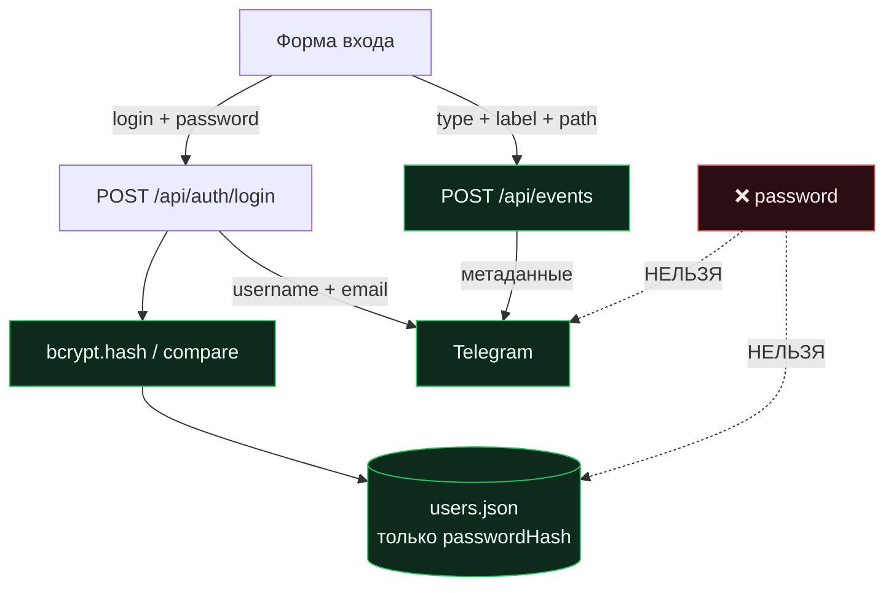

# 10. Куда уходят данные: полный разбор по файлам

<p align="center"></p>

Этот документ отвечает на вопросы:

- в каком файле читаются поля формы;
- в каком файле отправляется запрос;
- в каком файле формируется сообщение в Telegram;
- что именно уходит в Telegram, а что остаётся только на сервере;
- где проходит граница «можно / нельзя».

> **Главное.** Логин и пароль уходят **только** на ваш сервер по HTTPS в
> `POST /api/auth/login`. Пароль хешируется bcrypt и **никогда** не попадает
> в Telegram. В Telegram уходят только метаданные: событие, страница, время,
> IP, браузер/ОС. Значения полей формы в Telegram не отправляются.

---

## TL;DR — карта данных

| Что | Куда | Главный файл |
|---|---|---|
| Введённые `login` и `password` | `POST /api/auth/login` на ваш сервер | `client/src/pages/LoginPage.jsx` → `client/src/api.js` |
| Проверка пароля | `bcrypt.compare` на сервере | `server/src/routes/auth.js` |
| Хеш пароля | `server/data/users.json` | `server/src/store.js` |
| Событие «визит» / «клик» | `POST /api/events` на ваш сервер | `client/src/analytics.js` |
| Приём события | Express-роут | `server/src/routes/events.js` |
| Формирование текста | HTML-сообщение | `server/src/telegram.js` |
| Отправка в Telegram | `https://api.telegram.org/bot<TOKEN>/sendMessage` | `server/src/telegram.js` → `sendTelegram()` |
| IP и User-Agent | Из запроса | `server/src/routes/*.js` → `telegram.js` |
| Токен и chat_id | `server/.env` | `server/src/config.js` |

**Единственное место, где выполняется сетевой запрос к Telegram:**
`server/src/telegram.js`, функция `sendTelegram()`.

---

## Общая схема



---

## 1. `client/src/pages/LoginPage.jsx`

**Роль:** единственный экран входа. Здесь живут значения полей.

### Где хранятся поля

```jsx
const [login, setLogin] = useState("");
const [password, setPassword] = useState("");
```

Каждый `<input>` привязан к состоянию:

```jsx
<FloatingInput
  name="login"
  value={login}
  onChange={(e) => setLogin(e.target.value)}
/>

<FloatingInput
  name="password"
  type={showPassword ? "text" : "password"}
  value={password}
  onChange={(e) => setPassword(e.target.value)}
/>
```

То есть на момент отправки `login` и `password` — это строки в памяти браузера.

### Куда уходят значения

```jsx
const data = await api("/api/auth/login", {
  method: "POST",
  body: { login: login.trim(), password },
});
```

Это **единственное** место, где пароль покидает форму. Он уходит на ваш же
сервер по HTTPS, в `POST /api/auth/login`. Дальше в браузере он не используется
и очищается:

```jsx
setPassword("");
setInfo(`Вход выполнен: @${data.user.username}...`);
```

### Что делает аналитика

При открытии страницы:

```jsx
trackEvent("visit", "Открыта страница входа");
```

При клике по элементу с `data-track`:

```jsx
const target = event.target.closest("[data-track]");
trackEvent("click", target.getAttribute("data-track"));
```

В `trackEvent` передаётся **только название действия**, без значений полей.

### Чего здесь нет

- пароль не передаётся в `trackEvent`;
- логин не передаётся в `trackEvent`;
- в `data-track` нет динамических значений из `useState`.

---

## 2. `client/src/api.js`

**Роль:** тонкая обёртка над `fetch`.

```js
export async function api(path, { method = "GET", body, token } = {}) {
  const headers = {};
  if (body !== undefined) headers["Content-Type"] = "application/json";
  if (token) headers.Authorization = `Bearer ${token}`;

  const res = await fetch(BASE + path, {
    method,
    headers,
    body: body === undefined ? undefined : JSON.stringify(body),
  });

  ...
}
```

Что важно:

- `BASE = import.meta.env.VITE_API_URL || ""` — в продакшене пусто, запросы идут
  на тот же домен;
- тело запроса сериализуется в JSON;
- ошибки превращаются в человекочитаемые сообщения;
- файл не знает, «что» он отправляет — он просто передаёт `body`.

Именно сюда `LoginPage` передаёт `{ login, password }`. Дальше по сети идёт:

```json
{ "login": "demo_user", "password": "Password12345" }
```

---

## 3. `client/src/analytics.js`

**Роль:** отправка событий интерфейса.

```js
const ENDPOINT = `${import.meta.env.VITE_API_URL || ""}/api/events`;

export function trackEvent(type, label) {
  const payload = JSON.stringify({
    type,
    label: String(label || "").slice(0, 120),
    path: window.location.pathname,
  });

  if (navigator.sendBeacon) {
    const blob = new Blob([payload], { type: "application/json" });
    if (navigator.sendBeacon(ENDPOINT, blob)) return;
  }

  fetch(ENDPOINT, {
    method: "POST",
    headers: { "Content-Type": "application/json" },
    body: payload,
    keepalive: true,
  }).catch(() => {});
}
```

Что уходит:

```json
{
  "type": "visit",
  "label": "Открыта страница входа",
  "path": "/login"
}
```

Чего здесь нет:

- `password`;
- `login`;
- email;
- любых значений из `useState`.

`sendBeacon` используется, чтобы событие не блокировало переход и отправлялось
при закрытии вкладки. Если `sendBeacon` недоступен — обычный `fetch` с
`keepalive: true`.

---

## 4. `client/src/auth.js`

**Роль:** хранение JWT в `localStorage`.

```js
const KEY = "pixora_token";

export const getToken = () => localStorage.getItem(KEY);
export const setToken = (token) => localStorage.setItem(KEY, token);
export const clearToken = () => localStorage.removeItem(KEY);
```

Здесь **нет** пароля: только токен, который сервер выдал после успешного входа.

---

## 5. `server/src/index.js`

**Роль:** точка входа Express, middleware, роуты, статика.

Ключевые места:

```js
app.set("trust proxy", config.trustProxy ? 1 : false);
app.use(express.json({ limit: "16kb" }));
app.use("/api/auth", authLimiter, authRouter);
app.use("/api/events", eventsLimiter, eventsRouter);
```

- `trust proxy` нужен, чтобы `req.ip` был реальным IP клиента за nginx;
- `express.json` разбирает тело запроса, включая `login` и `password`;
- `authLimiter` — 30 попыток / 15 минут;
- `eventsLimiter` — 60 событий / минуту;
- лог запросов пишет только метод, URL, статус, время и IP — **тело не логируется**.

Именно здесь определяется, какие URL существуют:

| URL | Роутер |
|---|---|
| `/api/auth/login` | `server/src/routes/auth.js` |
| `/api/auth/me` | `server/src/routes/auth.js` |
| `/api/auth/logout` | `server/src/routes/auth.js` |
| `/api/events` | `server/src/routes/events.js` |
| `/api/health` | `server/src/index.js` |

---

## 6. `server/src/routes/auth.js`

**Роль:** приём логина/пароля, проверка, выдача JWT.

### Где читаются поля

```js
const login = String(req.body?.login || "").trim();
const password = String(req.body?.password || "");
```

Это **серверная** сторона: сюда пришёл JSON из `api.js`.

### Что происходит с паролем

```js
const user = findByLogin(login);
const ok = await bcrypt.compare(password, user?.passwordHash || DUMMY_HASH);

if (!user || !ok) return fail(res, 401, "Неверный логин или пароль.");
```

- пароль **не сохраняется** в открытом виде;
- сравнивается с bcrypt-хешем;
- для несуществующего пользователя всё равно выполняется сравнение
  (защита от определения аккаунта по времени ответа).

### Что уходит в Telegram

```js
notifyAuthEvent({
  event: "login",
  user,
  ip: clientIp(req),
  userAgent: req.get("user-agent") || "",
});
```

Обратите внимание: передаётся `user`, а **не** `password`. В объекте `user` есть
`id`, `email`, `username`, `createdAt` и `passwordHash`, но `notifyAuthEvent`
использует только `username` и `email`. Хеш пароля тоже не отправляется.

### Что возвращается в браузер

```js
return res.json({ token: signToken(user), user: publicUser(user) });
```

`publicUser()` отдаёт только `id`, `email`, `username`, `createdAt` — без хеша.

---

## 7. `server/src/routes/events.js`

**Роль:** приём событий «визит» и «клик».

```js
const ALLOWED = new Set(["visit", "click"]);

eventsRouter.post("/", (req, res) => {
  const event = String(req.body?.event || req.body?.type || "");
  const label = String(req.body?.label || "").slice(0, 120);
  const pagePath = String(req.body?.path || "").slice(0, 200);

  if (!ALLOWED.has(event) || !label) {
    return res.status(400).json({ error: "Некорректное событие." });
  }

  notifyUiEvent({
    event,
    label,
    pagePath,
    ip: req.ip || req.socket?.remoteAddress || "",
    userAgent: req.get("user-agent") || "",
  }).catch(() => {});

  return res.status(202).json({ ok: true });
});
```

Что важно:

- принимаются только `visit` и `click`;
- `label` обрезается до 120 символов;
- `path` — до 200;
- поля формы здесь **не читаются**;
- IP берётся из `req.ip` (с учётом `trust proxy`);
- User-Agent — из заголовка запроса.

---

## 8. `server/src/telegram.js` — здесь отправляется Telegram

Это главный файл для вопроса «где мы отправляем».

### 8.1. Единственный сетевой вызов

```js
async function sendTelegram(text) {
  if (!config.telegram.enabled) return { ok: false, skipped: "disabled" };
  if (!config.telegram.token || !config.telegram.chatId) {
    return { ok: false, skipped: "not-configured" };
  }

  const res = await fetch(
    `https://api.telegram.org/bot${config.telegram.token}/sendMessage`,
    {
      method: "POST",
      headers: { "Content-Type": "application/json" },
      body: JSON.stringify({
        chat_id: config.telegram.chatId,
        text,
        parse_mode: "HTML",
        disable_web_page_preview: true,
      }),
    }
  );

  ...
}
```

Именно этот `fetch` — единственное место, где приложение общается с Telegram.

### 8.2. Сообщение о входе

```js
export async function notifyAuthEvent({ event, user, ip, userAgent }) {
  const ipClean = normalizeIp(ip);
  const geo = await lookupGeo(ipClean);
  const when = formatTime(new Date());

  const lines = [
    `🔐 <b>Вход в аккаунт</b> · Pixora`,
    "",
    `👤 <b>Логин:</b> @${escapeHtml(user.username)}`,
    `📧 <b>Email:</b> ${escapeHtml(user.email)}`,
    `🕒 <b>Время:</b> ${escapeHtml(when)}`,
    `🌐 <b>IP:</b> <code>${escapeHtml(ipClean)}</code>`,
    `💻 <b>Устройство:</b> ...`,
  ];

  if (geo) lines.push(`📍 <b>Гео:</b> ${escapeHtml(geo)}`);
  lines.push("", "🔒 Пароль не передаётся и не сохраняется в открытом виде.");

  return sendTelegram(lines.join("\n"));
}
```

Здесь формируется текст. **Пароля в массиве `lines` нет.** Если добавить туда
`password`, это и будет отправка пароля в Telegram — так делать нельзя.

### 8.3. Сообщение о визите/клике

```js
export async function notifyUiEvent({ event, label, pagePath, ip, userAgent }) {
  const lines = [
    event === "visit"
      ? "👀 <b>Открыта страница</b> · Pixora"
      : "🖱️ <b>Клик на странице</b> · Pixora",
    "",
    `📄 <b>Страница:</b> <code>${escapeHtml(pagePath || "/")}</code>`,
    `🏷️ <b>Действие:</b> ${escapeHtml(label || "—")}`,
    `🕒 <b>Время:</b> ...`,
    `🌐 <b>IP:</b> <code>${escapeHtml(ipClean)}</code>`,
    `💻 <b>Устройство:</b> ...`,
  ];

  if (geo) lines.push(`📍 <b>Гео:</b> ${escapeHtml(geo)}`);
  lines.push("", "ℹ️ Учебный демо-проект Pixora. Данные формы не передаются.");

  return sendTelegram(lines.join("\n"));
}
```

### 8.4. Вспомогательные функции

| Функция | Что делает |
|---|---|
| `escapeHtml()` | экранирует `&`, `<`, `>` в тексте |
| `detectBrowser()` | определяет браузер по User-Agent |
| `detectOs()` | определяет ОС по User-Agent |
| `normalizeIp()` | убирает `::ffff:` и заменяет `::1` на `127.0.0.1` |
| `isPrivateIp()` | не делает гео-запрос для локальных IP |
| `lookupGeo()` | город по IP через `ip-api.com`, если `GEOIP_ENABLED=true` |
| `formatTime()` | время в часовом поясе `TZ_NAME` |
| `sendTelegram()` | отправляет JSON в Bot API |

---

## 9. `server/src/config.js`

**Роль:** читает `server/.env` и отдаёт настройки.

```js
telegram: {
  enabled: process.env.TELEGRAM_ENABLED !== "false",
  token: (process.env.TELEGRAM_BOT_TOKEN || "").trim(),
  chatId: (process.env.TELEGRAM_CHAT_ID || "").trim(),
},
```

Если `TELEGRAM_ENABLED=false` или пустые `TELEGRAM_BOT_TOKEN` /
`TELEGRAM_CHAT_ID`, `sendTelegram()` просто ничего не отправит.

---

## 10. `server/src/store.js`

**Роль:** JSON-хранилище пользователей.

```js
const user = {
  id: crypto.randomUUID(),
  email: norm(email),
  username: norm(username),
  passwordHash,
  createdAt: new Date().toISOString(),
};
```

В файле `server/data/users.json` лежит **хеш**, а не пароль:

```json
{
  "users": [
    {
      "id": "...",
      "email": "demo@example.com",
      "username": "demo_user",
      "passwordHash": "$2a$12$...",
      "createdAt": "..."
    }
  ]
}
```

`publicUser()` удаляет `passwordHash` перед отправкой в браузер.

---

## 11. `server/scripts/add-user.js`

**Роль:** создание демо-аккаунта из командной строки.

```bash
npm run user:add -- demo@example.com demo_user "Пароль12345"
```

Скрипт:

1. проверяет email/логин/пароль;
2. делает `bcrypt.hash(password, 12)`;
3. сохраняет только `passwordHash`;
4. печатает `Готово: @demo_user`.

Пароль в открытом виде нигде не сохраняется.

---

## 12. `deploy/`

| Файл | Роль |
|---|---|
| `deploy/nginx.conf` | принимает 80/443 и проксирует на `127.0.0.1:4000` |
| `deploy/pixora-api.service` | systemd-сервис Node.js |
| `deploy/deploy.sh` | обновление: `git pull` → `npm install` → `build` → `restart` |

Важно для IP: nginx передаёт `X-Forwarded-For`, а `TRUST_PROXY=true` в `.env`
разрешает Express брать IP из этого заголовка. Без этого в Telegram был бы
`127.0.0.1`.

---

## Полный путь логина



**Вывод:** пароль доходит только до `routes/auth.js` и `bcrypt.compare`.
В `telegram.js` он не передаётся.

---

## Полный путь визита и клика



---

## Что именно уходит в Telegram

| Поле | Источник | Пример |
|---|---|---|
| Тип события | `event` | `visit` / `click` / `login` |
| Действие | `label` | `Нажата кнопка «Войти»` |
| Страница | `path` | `/login` |
| Время | сервер | `26.11.2026, 14:32` |
| IP | `req.ip` | `203.0.113.10` |
| Браузер | User-Agent | `Chrome` |
| ОС | User-Agent | `Windows` |
| Гео | `ip-api.com` (если включено) | `Москва, Russia` |
| Логин | `user.username` (только при входе) | `@demo_user` |
| Email | `user.email` (только при входе) | `demo@example.com` |

## Что **не** уходит в Telegram

| Данные | Почему |
|---|---|
| Пароль | никогда не передаётся в `telegram.js` |
| Хеш пароля | не включается в `lines` |
| Значения полей логина | `analytics.js` отправляет только `type/label/path` |
| Значения поля пароля | не читаются в `trackEvent` |
| JWT | остаётся в браузере в `localStorage` |
| Тело запроса `/api/auth/login` | не логируется в `index.js` |

---

## Граница безопасности



**Правило:** если данные чувствительные (пароль, токен, платёжные данные),
они не должны попадать в чат, мессенджер, логи или сторонний сервис.

---

## Как проверить самостоятельно

### 1. Найти все места отправки в Telegram

```bash
grep -rn "api.telegram.org" server/src
```

Должен быть только `server/src/telegram.js`.

### 2. Найти, где формируется текст

```bash
grep -rn "lines" server/src/telegram.js
```

### 3. Убедиться, что пароль не попадает в Telegram

```bash
grep -rn "password" server/src/telegram.js
```

В `telegram.js` не должно быть `password` в `lines`. Сейчас там только
упоминание в комментарии и в тексте «Пароль не передаётся».

### 4. Посмотреть запросы в браузере

1. Откройте `/login`.
2. DevTools → **Network**.
3. Введите данные и нажмите «Войти».
4. Найдите `login` — в Payload будут `login` и `password`.
5. Найдите `events` — в Payload будут только `type`, `label`, `path`.

### 5. Проверить сервер вручную

```bash
curl -X POST https://example.com/api/events \
  -H "Content-Type: application/json" \
  -d '{"type":"visit","label":"Проверка","path":"/login"}'
# {"ok":true}
```

В Telegram придёт сообщение без данных формы.

### 6. Посмотреть логи

```bash
sudo journalctl -u pixora-api -n 50 --no-pager
```

В логах будут метод, URL, статус, время и IP — без тела запроса и пароля.

---

## Как добавить новое событие безопасно

1. Придумайте **название действия**, а не данные:
   - ✅ `Нажата кнопка «Показать пароль»`
   - ❌ `Пароль: 12345`
2. Добавьте `data-track` в JSX:
   ```jsx
   <button data-track="Нажата кнопка «Показать пароль»">Показать</button>
   ```
3. Не передавайте в `trackEvent` значения из `useState`.
4. На сервере принимайте только `type`, `label`, `path`.
5. В `telegram.js` не добавляйте в `lines` ничего из `req.body`, кроме
   разрешённых метаданных.
6. Проверьте `grep -rn "password" server/src/telegram.js`.

---

## Частые вопросы

**В каком файле мы отправляем в Telegram?**
В `server/src/telegram.js`, функция `sendTelegram()`. Она вызывается из
`notifyAuthEvent()` и `notifyUiEvent()`.

**В каком файле читаются поля формы?**
В `client/src/pages/LoginPage.jsx` — в состоянии `login` и `password`.
На сервере — в `server/src/routes/auth.js` через `req.body`.

**Куда уходит пароль?**
Только в `POST /api/auth/login` на ваш сервер. Там он сравнивается с
bcrypt-хешем и дальше не передаётся.

**Почему в Telegram нет пароля?**
Потому что `notifyAuthEvent()` получает `user`, а не `password`, и формирует
`lines` только из `username`, `email`, времени, IP и устройства.

**Можно ли добавить email в событие клика?**
Технически да, но не нужно: это лишние персональные данные. Для аналитики
достаточно действия и страницы.

**Можно ли отправлять пароль в Telegram «для теста»?**
Нет. На публичном сайте нельзя отличить тестовый пароль от настоящего, а
Telegram не является защищённым хранилищем. Это фишинг и нарушение закона.

---

## Связанные документы

- [09-animated-architecture.md](09-animated-architecture.md) — архитектура и деплой.
- [08-vps-full-guide.md](08-vps-full-guide.md) — полный гайд по VPS.
- [06-security.md](06-security.md) — безопасность и чек-лист.
- [04-telegram.md](04-telegram.md) — настройка бота.

<p align="center"></p>

<p align="center">
  <b>Pixora</b> — учебный демо-проект.<br/>
  Пароли остаются на сервере в виде bcrypt-хеша и не уходят в Telegram.
</p>
