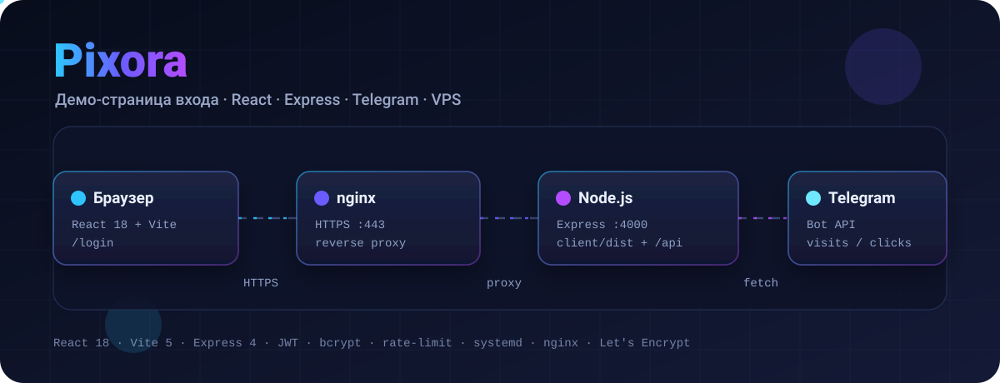
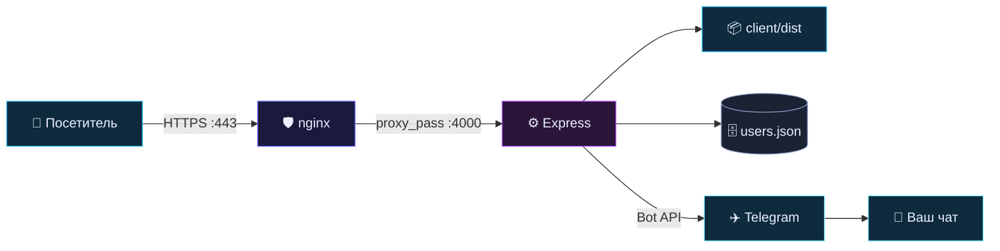
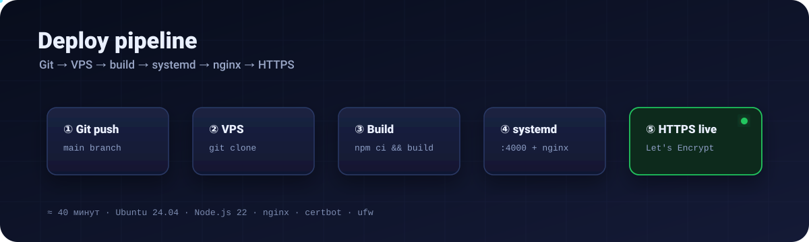
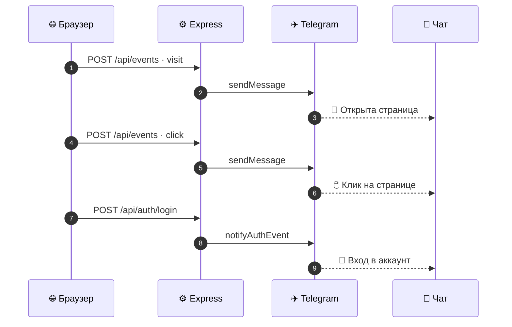
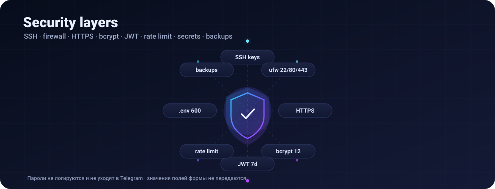
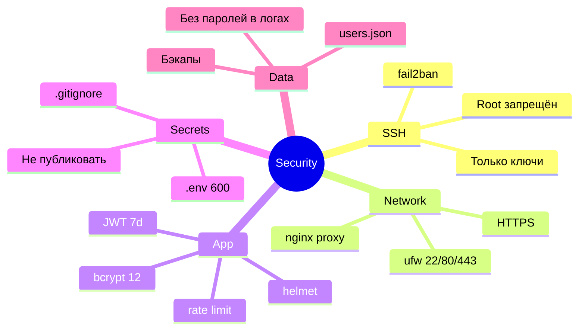

<p align="center">
  
</p>

<h1 align="center">Pixora · Documentation</h1>

<p align="center">
  <b>React + Express + Telegram + VPS</b><br/>
  Учебный демо-проект страницы входа под собственным брендом.
</p>

<p align="center">
  
  
  
  
  
  
</p>

<p align="center">
  <a href="#быстрый-старт">🚀 Быстрый старт</a> ·
  <a href="#архитектура">🧠 Архитектура</a> ·
  <a href="#деплой-на-vps">🛠️ Деплой</a> ·
  <a href="#события-telegram">✈️ События</a> ·
  <a href="#безопасность">🛡️ Безопасность</a> ·
  <a href="#все-документы">📚 Все документы</a>
</p>


> **Важно.** Это демо под брендом **Pixora**. Проект не является копией Instagram,
> не использует логотипы Instagram/Meta и не предназначен для сбора чужих паролей.
>
> **Про анимацию.** SVG-схемы анимированы и оживают в браузере. Mermaid-диаграммы
> анимируются в рендерерах, которые это поддерживают; на GitHub они статичны,
> но полностью читаемы.

---

## Быстрый старт

```bash
# 1. Зависимости
npm install

# 2. Конфиг
cp server/.env.example server/.env
# JWT_SECRET, TELEGRAM_BOT_TOKEN, TELEGRAM_CHAT_ID

# 3. Демо-аккаунт
npm run user:add -- demo@example.com demo_user "Пароль12345"

# 4. Запуск
npm run dev
# http://localhost:5173/login
```

Production-сборка:

```bash
npm run build
npm start
# http://localhost:4000/login
```

---

## Архитектура



**Один Node-процесс** отдаёт React-сборку и API. **nginx** принимает HTTPS и
проксирует всё на `127.0.0.1:4000`. **Telegram** получает только метаданные
событий: действие, страницу, время, IP, браузер/ОС.

---

## Деплой на VPS

```mermaid
gantt
    title Деплой Pixora на VPS (~40 минут)
    dateFormat  HH:mm
    axisFormat  %H:%M
    section Подготовка
    VPS + SSH + обновление системы      :a1, 00:00, 10m
    Пользователь, ключи, ufw            :a2, after a1, 10m
    section Установка
    Node.js, nginx, certbot             :b1, after a2, 8m
    Клон и сборка                       :b2, after b1, 6m
    section Запуск
    .env + демо-аккаунт                 :c1, after b2, 4m
    systemd + nginx                     :c2, after c1, 5m
    section HTTPS
    DNS + certbot                       :d1, after c2, 8m
    Проверка                            :d2, after d1, 5m
```

<p align="center">
  
</p>



Кратко:

```bash
# Сервер
apt update && apt upgrade -y
apt install -y git curl ufw nginx certbot python3-certbot-nginx
curl -fsSL https://deb.nodesource.com/setup_22.x | sudo bash -
apt install -y nodejs

# Firewall
ufw allow OpenSSH && ufw allow 80/tcp && ufw allow 443/tcp && ufw enable

# Код
mkdir -p /var/www && chown $USER:$USER /var/www
cd /var/www && git clone https://github.com/JamikKhidirov/InstWeb.git pixora
cd pixora && npm ci && npm run build

# Конфиг
cd server && cp .env.example .env && chmod 600 .env
nano .env    # NODE_ENV=production, JWT_SECRET, домен, Telegram
cd .. && npm run user:add -- demo@example.com demo_user "Пароль12345"

# systemd + nginx
cp deploy/pixora-api.service /etc/systemd/system/
systemctl daemon-reload && systemctl enable --now pixora-api
cp deploy/nginx.conf /etc/nginx/sites-available/pixora
nano /etc/nginx/sites-available/pixora   # server_name = ваш домен
ln -sf /etc/nginx/sites-available/pixora /etc/nginx/sites-enabled/pixora
rm -f /etc/nginx/sites-enabled/default
nginx -t && systemctl reload nginx

# HTTPS
certbot --nginx -d example.com -d www.example.com
```

Подробно — [08-vps-full-guide.md](08-vps-full-guide.md).

---

## События Telegram

<p align="center">
  
</p>



Что уходит в сообщении:

| Поле | Пример |
|---|---|
| Действие | `Открыта страница входа` |
| Страница | `/login` |
| Время | `26.11.2026, 14:32 (Europe/Moscow)` |
| IP | `203.0.113.10` |
| Устройство | `Chrome · Windows` |
| Гео | `Москва, Russia` (если включено) |

Чего **нет**: логина, email, пароля и значений полей формы.

---

## Безопасность

<p align="center">
  
</p>



---

## Все документы

| # | Документ | О чём |
|---|---|---|
| 01 | [Локальный запуск](01-local-start.md) | Node, `.env`, первый запуск, типичные ошибки |
| 02 | [VPS с нуля](02-vps-deploy.md) | SSH, пользователь, firewall, Node, systemd, nginx |
| 03 | [Домен и HTTPS](03-domain-https.md) | DNS, Let's Encrypt, автопродление |
| 04 | [Telegram](04-telegram.md) | BotFather, chat_id, формат сообщений, диагностика |
| 05 | [Troubleshooting](05-troubleshooting.md) | Симптом → причина → решение |
| 06 | [Безопасность](06-security.md) | Что храним, что нет, чек-лист |
| 07 | [GitHub](07-github.md) | Публикация без утечки секретов |
| 08 | [Полный гайд по VPS](08-vps-full-guide.md) | Всё вместе: от сервера до бэкапов |
| 09 | [Анимированная архитектура](09-animated-architecture.md) | SVG, Mermaid, последовательности, деплой |

---

## FAQ

| Вопрос | Ответ |
|---|---|
| Где страница входа? | `/login`, все остальные адреса редиректят туда |
| Есть регистрация? | Нет, демо-аккаунт создаёт администратор командой `npm run user:add` |
| Уходят ли пароли в Telegram? | Нет, только метаданные событий |
| Почему нет логотипа Instagram? | Это чужой товарный знак; проект использует свой бренд Pixora |
| Как выключить уведомления? | `TELEGRAM_ENABLED=false` в `server/.env` |
| Как обновить сайт? | `bash deploy/deploy.sh` на сервере |
| Где логи? | `sudo journalctl -u pixora-api -f` |
| Как сделать бэкап? | См. [08-vps-full-guide.md](08-vps-full-guide.md#19-бэкапы) |

---

<p align="center">
  
</p>

<p align="center">
  <b>Pixora</b> — учебный демо-проект.<br/>
  React · Express · Telegram · VPS · HTTPS<br/>
  Не связан с Instagram или Meta.
</p>
